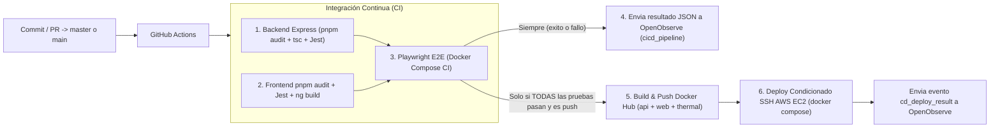
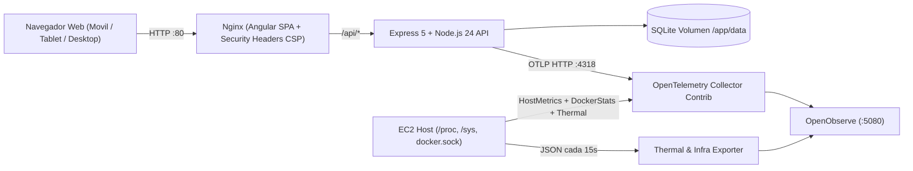

# 🧸 ToyStore — Full-Stack Express + Angular 22, CI/CD, Playwright E2E y Observabilidad con OpenObserve


Plataforma integral **ToyStore** orientada a la gestión e inventario de juguetería, diseñada con **Arquitectura de Entrega Continua (CI/CD), Pruebas Automatizadas y Observabilidad**.

Incluye **Backend REST (Node.js 24 + Express 5 + TypeScript + SQLite + OpenTelemetry OTLP)**, **Frontend Profesional (Angular 22 Standalone + Signals + `pnpm` + Tailwind v4 + `@lucide/angular` + Nginx Hardening OWASP)**, pruebas integrales (**Jest + Supertest + Playwright E2E**), pipeline bloqueante en **GitHub Actions** y monitoreo unificado en **OpenObserve** (trazabilidad CI/CD, trazas/métricas/logs de aplicación y métricas de infraestructura EC2: CPU, RAM, Ancho de Banda y Temperatura).

---

## 🏛️ Arquitectura General del Sistema y Flujo CI/CD





---

## 🛠️ Stack Tecnológico

* **Frontend (`frontend/`):** Angular 22.3 (Standalone Components, Signals, Lazy Loading), gestor **`pnpm`**, **Tailwind CSS v4**, iconos **`@lucide/angular`**, tipografías auto-hospedadas **`@fontsource/inter`** y **`@fontsource/jetbrains-mono`**, pruebas unitarias con **Jest (`jest-preset-angular`)** y servidor **Nginx 1.27 Alpine** con cabeceras OWASP (`CSP`, `X-Frame-Options: DENY`, `X-Content-Type-Options: nosniff`, `Referrer-Policy`, `Permissions-Policy`, `COOP`, `CORP`).
* **Backend (`backend/`):** Node.js 24 + Express 5 + TypeScript + SQLite (`node:sqlite`), autenticación JWT con cookie **`HttpOnly; SameSite=Lax`** (`toystore_auth`) + soporte `Bearer`, protección CSRF (`X-Requested-With: XMLHttpRequest`), Rate Limiting en `/api/auth/*`, `bcryptjs`, validación con `zod` y **OpenTelemetry** (`Logs`, `Metrics`, `Traces` vía OTLP/HTTP).
* **Pruebas (`backend/tests/`, `frontend/`, `e2e/`):** Jest + Supertest (>90% línea en backend), Jest en frontend y **Playwright** (API, UI Auth, CRUD Juguetes, CRUD Usuarios, Responsividad 375px/768px/1440px y cabeceras de seguridad).
* **Observabilidad (`observability/`):** **OpenObserve**, **OpenTelemetry Collector Contrib** (`hostmetrics`, `docker_stats`, `otlp`), **Thermal Exporter** (CPU, RAM, ancho de banda RX/TX, carga y temperatura real o modelo térmico EC2), 4 tableros JSON listos para importar y 3 alertas operativas.

---

## 📋 Endpoints de la API REST

| Método | Endpoint | Descripción | Acceso |
| :--- | :--- | :--- | :--- |
| `GET` | `/api/health` | Estado del API y conectividad SQLite | Público |
| `POST` | `/api/auth/register` | Registro de usuario cliente | Público (Rate Limited) |
| `POST` | `/api/auth/login` | Autenticación JWT + cookie `HttpOnly` | Público (Rate Limited) |
| `GET` | `/api/auth/me` | Perfil completo del usuario autenticado | Autenticado |
| `POST` | `/api/auth/logout` | Cierre de sesión y borrado de cookie | Público / Autenticado |
| `GET` | `/api/users` | Listado paginado y filtrado (`q`, `isActive`) | `Admin` |
| `GET` | `/api/users/{id}` | Detalle de usuario (protección IDOR) | Owner o `Admin` |
| `GET` | `/api/users/search?q=` | Búsqueda de usuarios | `Admin` |
| `POST` | `/api/users` | Crear usuario con rol explícito | `Admin` |
| `POST` | `/api/users/{id}/profile` | Actualizar datos de perfil | Owner o `Admin` |
| `POST` | `/api/users/{id}/password` | Cambiar contraseña | Owner o `Admin` |
| `PATCH` | `/api/users/{id}/status` | Activar o desactivar cuenta | `Admin` |
| `PATCH` | `/api/users/{id}/role` | Cambiar rol del usuario | `Admin` |
| `DELETE` | `/api/users/{id}` | Baja lógica del usuario | Owner o `Admin` |
| `GET` | `/api/products` | Listado paginado + stats + filtros | Autenticado |
| `GET` | `/api/products/{id}` | Detalle de juguete | Autenticado |
| `POST` | `/api/products` | Crear juguete (SKU único, validación URL) | `Admin` |
| `PUT` | `/api/products/{id}` | Actualizar juguete | `Admin` |
| `DELETE` | `/api/products/{id}` | Eliminar juguete | `Admin` |
| `POST` | `/api/admin/backup` | Respaldo SQLite (`VACUUM INTO`) | `Admin` |
| `GET` | `/api/admin/backups` | Listado de respaldos disponibles | `Admin` |
| `GET` | `/api/admin/backup/{fileName}` | Descarga segura de respaldo `.db` | `Admin` |
| `DELETE` | `/api/admin/database` | Limpieza y re-seed de la BD | `Admin` |

### Credenciales iniciales (Seed)
- **Administrador:** `admin@toystore.com` / `Admin123!`
- **Cliente demo:** `customer@toystore.com` / `Customer123!`

---

## 💻 Ejecución Local (Desarrollo y Pruebas)

### 1. Backend (Express + TypeScript + SQLite)
```bash
pnpm --dir backend install
pnpm --dir backend audit --audit-level=high
pnpm --dir backend run build
pnpm --dir backend run test:ci
pnpm --dir backend run dev   # Inicia en http://127.0.0.1:3000
```

### 2. Frontend (Angular 22 + pnpm)
```bash
pnpm --dir frontend install
pnpm --dir frontend run test:ci
pnpm --dir frontend run build
pnpm --dir frontend start   # Inicia en http://localhost:4200 con proxy /api -> :3000
```

### 3. Pruebas E2E con Playwright
```bash
pnpm --dir e2e install
pnpm --dir e2e exec playwright install chromium
E2E_BASE_URL=http://127.0.0.1:4200 pnpm --dir e2e test
```

---

## 🔐 Secretos de GitHub Actions (`Repository secrets`)

Configurar en **Settings → Secrets and variables → Actions → Secrets** en tu repositorio:

| Secreto | Descripción |
| :--- | :--- |
| `DOCKERHUB_USERNAME` | Usuario de Docker Hub |
| `DOCKERHUB_TOKEN` | Personal Access Token (Read/Write) de Docker Hub |
| `EC2_HOST` | IPv4 pública o DNS de la instancia AWS EC2 |
| `EC2_USER` | Usuario SSH (ej. `ubuntu`) |
| `EC2_SSH_KEY` | Llave privada `.pem` completa |
| `JWT_KEY` | Clave secreta JWT aleatoria (mínimo 32 caracteres) |
| `OPENOBSERVE_URL` | URL pública de OpenObserve (ej. `http://<EC2_HOST>:5080`) |
| `OPENOBSERVE_ORG` | Organización de OpenObserve (por defecto `default`) |
| `OPENOBSERVE_USER` | Correo del usuario administrador de OpenObserve |
| `OPENOBSERVE_PASSWORD` | Contraseña de OpenObserve |

---

## ☁️ Aprovisionamiento de AWS EC2 y OpenObserve

1. **Requisitos de Instancia EC2:**
   * AMI: Ubuntu Server 22.04 / 24.04 LTS.
   * Tipo recomendado: **`t3.small`** (2 GB RAM) o `t3.micro` con 2 GB de swap habilitado.
   * **Security Group (Reglas de Entrada):**
     * Puerto `22` (SSH) — despliegue desde GitHub Actions.
     * Puerto `80` (HTTP) — aplicación ToyStore (Nginx + API Express).
     * Puerto `5080` (TCP) — interfaz web y API de ingesta de OpenObserve.

2. **Instalación inicial en EC2 (una sola vez por SSH):**
   ```bash
   sudo apt update && sudo apt install -y docker.io docker-compose-v2 curl python3
   sudo systemctl enable --now docker
   sudo usermod -aG docker ubuntu

   # Crear swap de 2 GB (recomendado en t3.micro)
   sudo fallocate -l 2G /swapfile && sudo chmod 600 /swapfile
   sudo mkswap /swapfile && sudo swapon /swapfile
   echo '/swapfile none swap sw 0 0' | sudo tee -a /etc/fstab
   ```

3. **Importar Dashboards y Alertas en OpenObserve:**
   Tras el primer despliegue exitoso en `/opt/toystore`:
   ```bash
   set -a && source /opt/toystore/.env && set +a
   OPENOBSERVE_URL="http://localhost:5080" bash /opt/toystore/observability/scripts/provision-openobserve.sh
   ```
